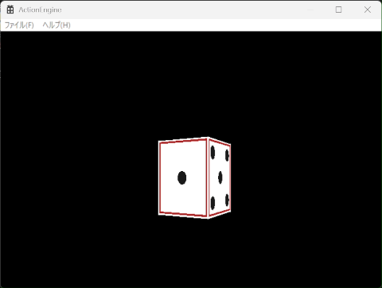
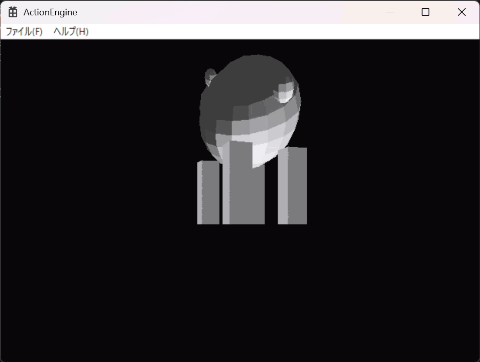
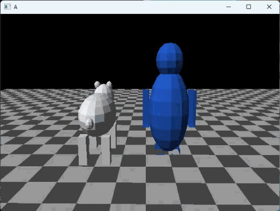

# ActionEngine ユーザーストーリー

## Phase 0:プロトタイプ(2026年6月上旬〜6/21)

**背景**

個人制作としてCGエンジンを作る構想があり、GPUをブラックボックスとして使うのではなく、描画パイプラインの中身を自分で実装して理解したいと考えていた。そこへ第一志望企業のインターン募集が始まったため、期間が限られる中で、まず形にすることを優先した。

**ユーザーストーリー**

ゲーム会社のインターンに応募する学生として、限られた期間で、自分がグラフィックスの仕組みを理解していることを示せる作品を用意したい。

**タスク**
- 数学ライブラリ(Vector3・Matrix4x4・Quaternion)
- ワールド・ビュー・プロジェクション変換
- 透視除算とビューポート変換
- 重心座標による三角形の塗りつぶし
- Zバッファ
- Win32 GDIによる表示

**完成条件**
- 回転する立方体が、面の前後関係を正しく保ったまま表示される

**実績**
- 期間:2026年6月上旬〜6/21
- 結果:SoftwareRasterizerとしてGitHubに公開し、インターンに応募した(選考は通過せず)
- 根拠:[SoftwareRasterizer](https://github.com/NomToy0613/SoftwareRasterizer)

**振り返り**
- 良かった点:短期間で、頂点変換から画面表示までのパイプラインを一通り動かし、公開と応募まで終えられた
- 課題:計画を立てずに進めたため、作業の記録が残っていない(GitHubにはまとめてアップロードしたので履歴がない)。クリッピング、テクスチャ、ライティングは未実装のまま
- 次への改善:機能を計画的に積み上げるため、Phase 1ではユーザーストーリーとSprintを導入する

## Phase 1:アジャイル開発の導入(計画:8/3〜9/26、実績:8月下旬〜9/13)

**背景**

前期の授業で学んだアジャイル開発の考え方を取り入れ、ActionEngineとしてのロードマップを作成した。1週間を1 Sprintとし、Sprintごとにユーザーストーリーと完成条件を決めて機能を積み上げる。当初の計画は9 Sprintで、エンジンとサンプルゲームを完成させてGitHubで公開するv1.0を9/26に予定していた。

### Sprint 1:レンダリング品質向上①(計画:8/3〜8/9)

**ユーザーストーリー**

エンジン利用者として、不要なポリゴンが描画されず、安定した3D描画を行いたい。

**タスク**
- Back Face Culling
- Near Plane Clipping
- クリッピングのデバッグ
- リファクタリング

**完成条件**
- 裏面が描画されない
- カメラがモデルにめり込んでも破綻しない

**実績**
- 期間:8月下旬〜(当初計画:8/3〜8/9)
- 結果:完了。完成条件の2つを満たした
- 根拠:—(当時のコミット履歴は残っていない。Phase 2を参照)

**振り返り**
- 苦労した点:最初はニア面を他の面と同じ順番でクリップしていたため、wが0以下の頂点が後のクリップ処理を壊してフリーズした。クリップする面の配列でニア面を先頭に置くことで解決した
- 後から見つかった不具合:左・下の面のクリッピングと交点でのUV補間に不具合があり、Sprint 7の作業中(10/16)に発見・修正した。画面の端にかかる大きな面(地面)を描くまで、この不具合は目に見えなかった

### Sprint 2:マテリアル(計画:8/10〜8/16)

**ユーザーストーリー**

エンジン利用者として、モデルに画像を貼り付けて描画したい。

**タスク**
- Texture Class
- BMP Loader
- UV
- Perspective Correct Interpolation
- Texture Mapping

**完成条件**
- 立方体へテクスチャが正しく貼れる

**実績**
- 期間:8月下旬〜9/8(当初計画:8/10〜8/16)
- 結果:完了。立方体の各面にサイコロのテクスチャを正しく貼れた
- 根拠:9/8の録画(下のGIF)

**振り返り**
- 実装のポイント:UVをそのまま画面上で線形補間すると、奥行きのある面でテクスチャが歪む。頂点ごとに u/w・v/w・1/w を持たせて補間し、ピクセルごとに w で割り戻すことで、遠近を正しく反映した(パースペクティブコレクト補間)
- 記録の課題:当時の作業記録を残していなかったため、どこで苦労したかを後から振り返れない(→ Phase 3では作業記録とテスト結果を残す)

### Sprint 3:ライティング・モデル読み込み(計画:8/17〜8/23)

**ユーザーストーリー**

エンジン利用者として、3Dモデルに陰影を付けて描画したい。

**タスク**
- Directional Light
- Lambert Lighting
- OBJ Loader
- Material

**完成条件**
- OBJモデルを光付きで表示できる

**実績**
- 期間:〜9/10(当初計画:8/17〜8/23)
- 結果:完了。Pythonで生成した白熊のOBJモデルを、平行光源による陰影付きで表示できた
- 根拠:9/10の録画(下のGIF)

**振り返り**
- 実装のポイント:三角形ごとに辺の外積から面法線を求め、光の向きとの内積で明るさを決めるフラットシェーディングにした。真っ暗になる面がないよう、環境光(0.25)を足している
- 後から見つかった不具合:Pythonで生成したOBJモデルの一部で、面の頂点の並び順(ワインディング)が逆になっており、背面カリングで面が消えて黒い筋が出ていた。目で見て気づき、モデル側を修正した(上のGIFは修正前)。ペンギンの手にも同じ問題が残っている(Sprint 9で修正予定)
- 開発環境でのトラブル:
  - Visual StudioのプロジェクトにOBJファイルを含めると、C++のオブジェクトファイル(.obj)と間違えてリンクしようとしてエラーになった。ファイルの設定を「ビルドに含めない」にして解決した
  - 同じ理由で、`.gitignore` の `*.obj` が3Dモデルまで除外してしまうことに注意が必要だった

### Sprint 4:Renderer(計画:8/24〜8/30)

**ユーザーストーリー**

エンジン利用者として、Renderer一つでモデルを描画したい。

**タスク**
- Mesh
- Renderer
- FrameBuffer Class
- DepthBuffer Class

**完成条件**
- `renderer.DrawMesh(mesh);` だけで描画できる

**実績**
- 期間:9月上旬(当初計画:8/24〜8/30)
- 結果:完了。座標変換・クリッピング・ラスタライズの処理をRendererの中にまとめ、`renderer.DrawMesh(mesh, material);` の1行でモデルを描画できるようにした
- 根拠:現在のコード(`Renderer/SoftwareRenderer.cpp` の `DrawMesh`)

**振り返り**
- 計画からの変更:完成条件では `DrawMesh(mesh)` としていたが、テクスチャや色をメッシュごとに切り替えられるよう、引数に `Material` を加えた
- 設計のポイント:
  - 描画先の色(FrameBuffer)と深度(DepthBuffer)をクラスとして分け、Rasterizerがそれぞれをメンバとして持つ形にした
  - 頂点データを表す `Vertex` を、計算用の `Vector3` と別の型にした。1つの型で位置も法線も表していると、ワールド変換の行列を誤って法線にも掛けてしまうバグが起きやすいため
- 残した機能:それまでのデモで使っていたサイコロの描画(`DrawDiceFrame`)は、比較用にRendererに残している

### Sprint 5:Engine Core(計画:8/31〜9/6)

**ユーザーストーリー**

ゲーム開発者として、入力や時間管理を気にせずゲームロジックを書きたい。

**タスク**
- Window
- Time
- Input
- Application

**完成条件**
- `Input::GetKey(KeyCode::W);` で入力を取得できる

**実績**
- 期間:9月上旬(当初計画:8/31〜9/6)
- 結果:完了。ウィンドウ生成・メッセージ処理・時間計測・描画の呼び出しをApplicationクラスにまとめ、ゲーム側は `GameUpdate(deltaTime)` と `GameRender(renderer)` だけを書けばよい形にした。エントリーポイント(`wWinMain`)は、Applicationを作って `Initialize()` と `Run()` を呼ぶだけになった
- 根拠:現在のコード(`Application/` フォルダ、`Game/ActionEngine.cpp`)

**振り返り**
- 設計のポイント:
  - Windowクラスは「ウィンドウの生成とメッセージ処理」だけを担当し、ウィンドウプロシージャはApplicationから関数ポインタで渡す形にして、役割を分けた
  - Timeクラスで前のフレームからの経過時間(deltaTime)を計り、ゲームの動きがフレームレートに左右されないようにした
  - キーはWin32の仮想キーコードを直接使わせず、`KeyCode` という列挙型で表すようにした。将来別の環境へ移すときも、ゲーム側のコードを変えずに済む
- 残っている課題:
  - フレームレートの調整を `Sleep(16)` の固定待ちで行っている。DirectX 11版では画面の更新(垂直同期)を待つ処理と重なってしまうため、Sprint 8で見直す
  - 押されている間を調べる `GetKey` しかないため、「押した瞬間」を取りたいジャンプなどの操作には、別の関数(`GetKeyDown` など)が必要になる(v1.1のサンプルゲームで追加予定)

### Sprint 6:Scene(計画:9/7〜9/13)

**ユーザーストーリー**

ゲーム開発者として、ゲームオブジェクトを管理したい。

**タスク**
- Scene
- SceneManager
- GameObject
- Transform
- MeshRenderer

**完成条件**
- Sceneに複数オブジェクトを配置できる

**実績**
- 期間:〜9/13(計画どおり)
- 結果:完了。白熊・立方体・青いペンギンの3つのGameObjectを、1つのSceneに同時に配置して表示できた
- 根拠:現在のコード(`Scene/` フォルダ)

**振り返り**
- 設計のポイント:
  - GameObjectは位置・回転・大きさ(Transform)を持ち、描画はMeshRendererが担当する。表示しないオブジェクトも同じ仕組みで扱える
  - Sceneは `static` を使わず、描画に使うRendererを参照で受け取る形にした。グローバルな状態を持たないので、Sceneを複数作ったり、Rendererを別のものに差し替えたりできる(Sprint 8で、DirectX 11版のRendererに差し替える)
- 整理:TransformとProjectionを、置き場所として適切なフォルダへ移した

### Phase 1の振り返り

- 良かった点:実際に開発を始めた8月下旬から約3週間で、Sprint 1〜6を完了し、計画した描画機能とエンジンの基本構造を一通り実装できた。Phase 0のREADMEで「今後の拡張予定」に挙げていた項目の多く(ニアクリッピング、パースペクティブコレクト補間、テクスチャ、ライティング、シーン管理、入力、描画の抽象化)をここで実現した
- 課題:アルバイトや帰省の予定を考えずに「1週間に1 Sprint」の計画を立てたため、開発の開始が約3週間遅れた。その結果、Sprint 7以降(Physics・Portfolio・サンプルゲーム)は、v1.0の予定日である9/26までに手を付けられなかった
- 次への改善:使える時間を先に洗い出してから計画を立てる(→ Phase 3の開発計画書)

## 停滞期(9/14〜10/14)

Sprint 7(Physics)に着手できないまま、v1.0の予定日(9/26)を過ぎた。

## Phase 2:開発環境の移行と再始動(10/15〜10/16)

**背景**

後期の授業でLinux上でのGitとSSHの使い方を学んだ。そこで、Visual Studioで作っていたプロジェクトを新しいリポジトリに移し、WSL上でビルドできる環境に作り直して、開発を再開した。

**実施内容(10/15)**
- 新しいリポジトリを作成し、Phase 1までのファイルを登録。以降はSSHで接続し、機能ごとにコミットする形にした
- WSL上で MinGW-w64 を使い、Windows用の実行ファイルをビルドできるようにした(クロスコンパイル)
- ヘッダーの依存関係を自動で追跡する Makefile と、VS Code からビルドするための設定を追加
- ソースを Math / Application / Renderer / Scene / Game のフォルダに、素材を Assets/Textures・Assets/Models に整理

**移行で起きた問題**
- Windowsでは問題なかった `#include` が、Linuxではファイル名の大文字・小文字が区別されるためにビルドできなくなった。ファイル名を `#include` の書き方に合わせて修正した

**振り返り**
- Phase 0・1では残せなかった作業の履歴が、ここからはコミット単位で残るようになった
- 2台のPCで同じリポジトリを使うようになったため、作業前の `git pull` を忘れると変更が食い違うことが分かった(実際に一度起きた)

### Sprint 7:Physics(計画:9/14〜9/20)

**ユーザーストーリー**

ゲーム開発者として、キャラクターが地面を歩けるようにしたい。

**タスク**
- AABB
- Sphere
- Gravity
- CharacterController
- Camera Follow

**完成条件**
- プレイヤーが地面を歩ける

**実績**
- 期間:10/16(一部のみ)
- 結果:一部完了。チェッカー柄の地面と、キー入力によるプレイヤーの移動、Sceneから名前でオブジェクトを探す `Scene::Find` を実装した。当たり判定・重力・カメラ追従は未実装
- 根拠:コミット「Sprint 7: add ground, player movement, Scene::Find, UNICODE build flags」(10/16)

**振り返り**
- 同じ日に、Sprint 1で作ったクリッピングの不具合(左・下の面、交点でのUV補間)を発見して修正した。地面のように画面の端にかかる大きな面を描いたことで、初めて見つかった
- 計画変更:Physicsはサンプルゲームでしか使わないため、残りのタスクはサンプルゲームと一緒にv1.1へ移す(Phase 3を参照)
- 残っている不具合:ウィンドウのタイトルが「ActionEngine」ではなく「A」と表示される(上のGIF)。Sprint 9のテストで原因を調べて修正する

## Phase 3:工程管理の導入とv1.0(11/6〜11/30)

**背景**

後期の授業で、開発計画書・外部設計書・テスト仕様書を作り、計画→実装→テスト→リリースの順に進める開発の流れを学んだ。Phase 1の反省(使える時間を考えずに計画を立てたこと、テストの観点が足りず不具合が後から見つかったこと)を踏まえ、この流れをActionEngineにも取り入れる。あわせて、v1.0の範囲を見直し、PhysicsとサンプルゲームはV1.1に移した。

詳しい日程は[開発計画書](development-plan.md)を参照。

### Sprint 8:DirectX 11 バックエンド(計画:11/6〜11/16)

**ユーザーストーリー**

エンジン利用者として、同じSceneを、CPUで描くソフトウェア版とGPUで描くDirectX 11版のどちらでも表示し、切り替えて比べたい。

**タスク**
- D3D11の初期化(Device・DeviceContext・SwapChain・RenderTargetView)
- 三角形1枚の描画(シェーダ・頂点バッファ・インプットレイアウト)
- Rendererのインターフェース化(SoftwareRenderer / D3D11Renderer)
- D3D11Rendererでのメッシュ描画(行列・深度バッファ・ライティング・テクスチャ)
- キー入力によるバックエンドの切り替え
- フレームレート調整の見直し

**完成条件**
- 同じSceneを、キー1つでソフトウェア版とDirectX 11版に切り替えて表示できる

**実績**
- 期間:11/6(当初計画:11/6〜11/16)
- 結果:完了。Tabキーで、同じSceneをソフトウェア版とDirectX 11版に切り替えて表示できるようにした。DirectX 11版でも、深度バッファ、ソフトウェア版と同じフラットシェーディング、床のテクスチャを再現した
- 計測:D3D11版 144FPS(モニタのリフレッシュレートが上限)、ソフトウェア版 約64FPS
- 根拠:コミット「Sprint 8: ...」(11/6)

**振り返り**
- 設計のポイント:
  - Rendererをインターフェースにし、ソフトウェア版を `SoftwareRenderer`、GPU版を `D3D11Renderer` とした。Scene・GameObject・ゲーム側のコードは `Renderer&` を受け取る形のままなので、一切変更せずにGPU版で描けた
  - ActionEngineの数学ライブラリは、最初から左手座標系・深度0〜1・時計回りが表という、DirectXと同じ決まりで作っていた。そのため、合わせる必要があったのは行列のメモリの並び(HLSLの `row_major`)だけだった
  - GPUのピクセルシェーダには三角形の頂点の情報がないため、隣のピクセルとのワールド座標の差(`ddx`・`ddy`)の外積から面の法線を求めた。頂点データを変えずに、ソフトウェア版と同じフラットシェーディングを再現できた
- 見つかった不具合と対処:
  - 両方のRendererが約30FPSしか出ていなかった。FPSを計測して調べたところ、`Sleep(16)` はWindowsのタイマーの刻み(約15.6ミリ秒)のために実際には約31ミリ秒眠っており、これが上限になっていた。あわせて、時間の計測に使っていた `GetTickCount64` も同じ刻みのせいで粗かった。`QueryPerformanceCounter` に変え、`Sleep` を削除した
  - FPSの計測で、使っているモニタが144Hz対応なのに、Windowsの設定が60Hzのままだったことにも気づいた
  - シェーダのコンパイルに失敗すると、エラーを出すコンソールごとすぐに閉じてしまい、原因が読めなかった。初期化に失敗したときは、Enterキーを押すまで待つようにした
  - シェーダでテクスチャの色を取ったのに、最後に単色の方を返していて、床が単色のままだった。文法は正しいのでエラーにならず、画面を見て初めて気づく種類の不具合だった(→ Sprint 9で、見た目を確認するテスト項目を作る)
- 残っている課題:
  - GPU用のメッシュとテクスチャを、元のデータのアドレスで覚えている。読み込み直しや削除をするときには、リソース管理の仕組みが必要になる(v1.1以降)
  - ミップマップがないため、遠くの床のチェッカー柄がちらつく

### Sprint 9:テスト・デバッグ(計画:11/17〜11/23)

**ユーザーストーリー**

開発者として、エンジンが仕様どおりに動くことをテストで確かめ、見つかった不具合を、原因と対処の記録を残しながら直したい。

**タスク**
- 単体テスト項目表の作成と実施(数学ライブラリ、クリッピング、背面カリング、OBJ・BMPの読み込みなど)
- 総合テスト仕様書兼成績書の作成と実施(基本機能、描画機能、バックエンドの切り替え、性能、異常時の動作)
- 見つかった不具合の分類(エラー分類表)と修正
- 既に分かっている不具合の修正
  - ウィンドウのタイトルが「A」と表示される
  - ペンギンの手の面の向き(ワインディング)が逆
- パースペクティブコレクト補間のあり・なしの比較(テクスチャの歪みを確認する)
- 総合テスト完了報告書の作成

**完成条件**
- テスト項目をすべて実施し、NGになった項目は、修正済みか、対処方針が記録されている

**実績(途中経過)**
- 11/12:カメラの視点切り替え(C キーで一人称・三人称・俯瞰)を作り始め、三人称のカメラ追従まで完了(v1.1 の「カメラ追従」を前倒しで着手)
- 11/12:ペンギンとシロクマのモデルを作り直した。面の向きの不具合(手・足・くちばし、頭と胴体のてっぺんと底)が解消された。一人称・俯瞰・カメラ基準の移動・ペンギンの向き・ホイールでのズームまで完了

**振り返り**
- 見つかった不具合:三人称カメラで上から見られるようになったことで、ペンギンの頭と胴体のてっぺん・底の面が裏向きになっていて、穴が開いていることに気づいた。調べると、手だけでなく足とくちばしも逆だった
- モデルの作り直し:この期間、Claude Fable 5.2 が無料で使えたので、試しにモデルの生成スクリプト(`tools/make_models.py`)を作ってもらった。パーツごとに体積の符号を計算して面の向きをそろえる仕組みで、同じ不具合が起きないようにしている。色は、三角形ごとに色見本の画像(`palette.bmp`)の1色を UV で指す方式にした
- 組み込みで起きた問題:ダウンロードした `palette.bmp` の中身が PNG に変換されていて、BMP ローダーが読めずに単色で表示された。ファイルの先頭のバイトを `xxd` で確認して原因を特定し、WSL 上でスクリプトを実行して作り直した

### Sprint 10:Portfolio(計画:11/24〜11/30)

**ユーザーストーリー**

採用担当者として、ActionEngineの特徴や設計思想、実装内容を短時間で理解したい。

**タスク**
- READMEをポートフォリオ向けに書き直す(概要、特徴、開発の歩み、ビルド方法、資料へのリンク)
- 図の作成
  - アーキテクチャ図(Application・Renderer・Sceneの関係)
  - レンダリングパイプライン図(ソフトウェア版で自作した処理と、DirectX 11版でGPUが受け持つ段階の対応)
  - クラス図
- スクリーンショット・GIFの撮影
- デモ動画(2〜3分。ソフトウェア版とDirectX 11版を切り替える場面を含む)
- GitHubの整理(v1.0のRelease作成)

**完成条件**
- GitHubを開くだけで、何を作ったか、なぜ作ったか、どういう構成なのか、どこが技術的な強みなのかが3分以内に伝わる

### v1.0リリース(11/30予定)

- ソフトウェア版とDirectX 11版の2つのレンダラーを持つ描画エンジン
- ユーザーストーリー、開発計画書、テスト仕様書兼成績書
- README、デモ動画

## v1.1:Physicsとサンプルゲーム(12月以降)

**背景**

当初の計画のSprint 7(Physics)とSprint 9(Sample Game)を、v1.0の範囲から外してここにまとめた。ゲーム会社への応募の前に完成させる。

**ユーザーストーリー**

プレイヤーとして、ActionEngineで作られた3Dアクションゲームを実際に遊びたい。

**タスク**
- Physics:AABB、Sphere、重力、CharacterController、カメラ追従
- 入力:押した瞬間を取得する `GetKeyDown` の追加
- サンプルゲーム:ステージ、プレイヤー、敵、UI、クリア条件

**完成条件**
- ActionEngineだけで作ったサンプルゲームを公開する